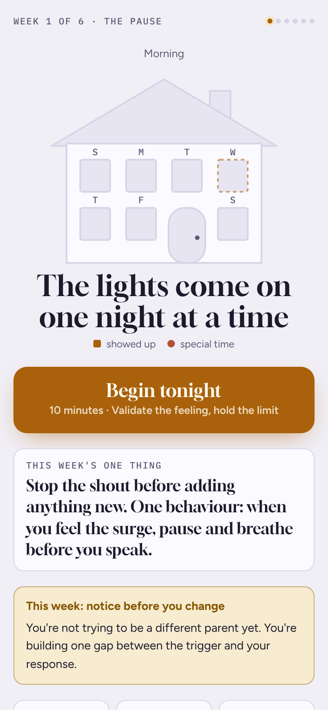
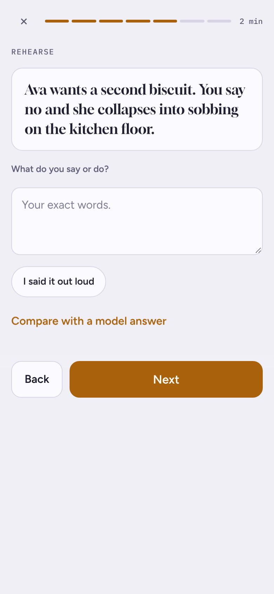

# Calm Parent Practice

A 10-minute nightly practice for parents who want to shout less and connect more. One evidence-graded idea a night, a drill, a rehearsal of a real scene, a plan for tomorrow, and a 60-second diary that counts behaviour instead of grading it.

**[Live demo](https://cdoor4.github.io/calm-parent-practice/)** · single HTML file · no account · data stays on your device

## The problem

Parenting advice is everywhere and almost none of it changes behaviour in the moment that matters: 6pm, everyone tired, a cup of milk on the floor. Reading a book gives you knowledge; it doesn't give you a rehearsed response that fires under stress. The research on behaviour change is clear about what does: **retrieval practice, rehearsal, implementation intentions ("if X, then I'll do Y") and self-monitoring.** I built the engine I wanted around those four mechanisms.

## The nightly flow (≈10 minutes)

1. **Check in:** stress 0–10. **8+ turns tonight into a regulation night:** 5 minutes of guided cyclic sighing, then the diary only. The habit survives bad days.
2. **Recall (1 min):** a flip card testing yesterday's idea (spaced retrieval).
3. **Learn (2 min):** one idea, with its source.
4. **Drill (3 min):** the week's skill, with a breathing timer.
5. **Rehearse (2 min):** a realistic scene. Write your line, say it aloud, compare with a model answer.
6. **Plan (30 s):** tomorrow's if-then, phrased as what to *do*, not what to avoid.
7. **Diary (1 min):** counts (snaps, pauses, repairs, specific praise) and yes/no items.

The home screen shows the week as a **house whose windows light up night by night**, so progress is visible without streak-shaming. A weekly check-in tracks a simple self-pulse over time.

## Design principles

- **Counts, not grades.** "2 snaps today" is information. "Bad day" is shame, and shame makes people stop logging.
- **Substitution over negation.** Every plan says what to do instead (Adriaanse et al. 2011).
- **Repair over perfection.** The diary counts repairs, and the done screen replays a past "good moment" you wrote down: evidence of the parent you're becoming.
- **Respect the bad days.** The regulation-night branch means a high-stress evening still counts.
- **Private by default.** No account, no server; entries live in the browser.

## Architecture

The engine is content-agnostic. A course week is one JSON block (`<script type="application/json" id="week">`) defining 7 lessons, the drill, the diary counters, yes/no items, home-screen stats and weekly check-in questions. The same engine can run a parenting course, a communication course or a habit programme by swapping the config. That's what makes it practical to generate new weeks with an LLM from an evidence base and a learner's diary data, without touching code.

## Evidence base (week 1)

Lessons draw on: Gollwitzer & Sheeran 2006 (implementation intentions); Adriaanse et al. 2011 (substitution plans); Lieberman et al. 2007 (affect labelling); Gottman, Katz & Hooven 1996 and Havighurst et al. 2010 (emotion coaching); Tronick & Gianino 1986 (rupture and repair); Eyberg & Funderburk 2011 (PCIT: labelled praise and child-led play); Wang & Kenny 2014 (harsh verbal discipline); Balban et al. 2023 (cyclic sighing); Siegel & Bryson 2011; Kennedy 2022. All lesson text is my own summary. The demo family in the scenes is fictional.

## What I'd measure if this were a product

- **Week-1 → week-4 retention** (nights logged per week): the habit is the product.
- **Regulation-night share:** a leading indicator of who needs more support.
- **Diary trend:** snaps down, repairs and praise up, within a user.
- **Self-pulse trend** on the weekly check-in.

## Not a substitute for professional help

This is a skills-practice tool, not therapy. If you or a child are unsafe, contact your local emergency services or a parenting helpline.

## Built with

Vanilla HTML/CSS/JS, no dependencies. Designed and built with Claude Code.
